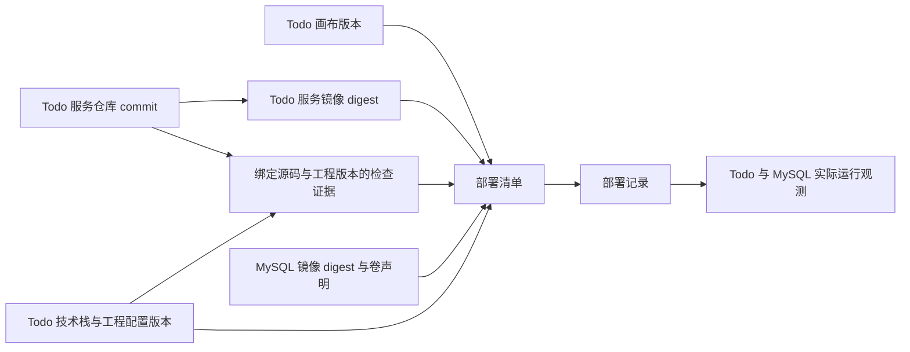

# 服务代码仓库与版本追溯设计

> **状态：仓库登记 / 固定 commit 与只读观察、隔离构建追溯已实现；完整仓库管理仍为设计。** 已建立能力见[源码切片](../development/local-project-slice.md)与[构建切片](../development/service-build-slice.md)。以下仓库创建、编辑与 GitHub 接入目标尚未实现，本文不授权创建真实仓库、推送或部署。

## 已确认的仓库方向

- 在 twine-realm 中，每创建一个业务服务，就为该服务配置一个独立 Git 仓库；未指定远端时，默认使用本地 Git 仓库。
- 选择 GitHub 时，支持两条初始化路径：先创建本地 Git 仓库再同步到 GitHub；先在 GitHub 创建仓库，再在本地建立对应的 Git 仓库。
- 一张画布可包含多个业务服务，因此可关联多个独立仓库。MySQL、RabbitMQ 等标准中间件使用目录中的镜像与声明，不因拖入画布就创建业务源码仓库。

Git 是版本管理基础，GitHub 是可选的远端托管服务。本地编辑、验证与部署的目标流程应能在未连接 GitHub 时完成；GitLab、自建 Git 等其他提供方暂不承诺实现。

## 示例项目：数据库版 Todo List

Todo List 在本文中仅作为**演示和验证最小端到端流程的示例项目**，用于贯通画布声明、服务开发、构建部署、数据库持久化与运行状态回显。它不是平台内置业务、固定项目模板或对实际用户项目类型的限制；实际项目按用户需求选择平台支持的技术栈与组件组合。

该示例项目的最小形态只包含两个画布组件：**一个 Todo 业务服务 + 一个 MySQL 标准中间件**。Todo 服务提供待办项的新增、列表查看、标记完成与删除，记录保存到项目的 MySQL；重启 Todo 服务后仍可读取已保存的数据。[部署切片](../development/service-deployment-slice.md)已用独立临时仓库验证这一流程；平台不内置 Todo 组件，也不自动生成业务源码。

- **Todo 服务**：配置一个独立 Git 仓库，默认本地，保存源码、测试、构建与工程规则配置，以及 Todo 表结构的迁移文件。
- **MySQL 中间件**：由画布声明与项目空间管理镜像、配置引用和持久化卷，不创建业务源码仓库；业务行数据与连接凭据不进入 Git。

项目 MySQL 与平台自身的元数据 MySQL 分开，Todo 数据不写入平台元数据库。该示例使用一个业务服务仓库；后续每增加一个业务服务，再为该服务配置独立 Git，延续既定仓库模型。

## 平台、项目空间与服务仓库

| 边界 | 保存内容 | 与其他边界的关系 |
| --- | --- | --- |
| 平台自身仓库 `hailingu/twine-realm` | Go 平台服务、React 前端、部署模板、设计与工程文档 | 业务服务源码由平台管理，但不写入平台自身仓库 |
| 项目 / 画布 | 组件、连接、配置引用、服务与仓库的关联 | 由平台服务持有已提交期望态；一个项目可以包含多个服务仓库 |
| 单个业务服务仓库 | 该服务的源码、测试、构建定义、相关迁移文件、工程检查配置与规则绑定快照 | 独立提交、构建与部署；可选关联 GitHub 远端 |
| 项目空间 | 服务与中间件的实际运行实例、网络与卷 | 对应画布，运行状态由采集与调和回显；销毁运行实例不等于删除源码仓库 |

平台管理的工作区可按下列逻辑组织。它是**布局示例**，实际根目录、命名与迁移方式待定；`projects/` 与项目目录只用于归组，不是共同的 Git 仓库。

```text
<平台管理的工作区>/
└── projects/
    └── todo/
        ├── AGENTS.md           # 示例项目规范入口，必须引用已登记的软件工程规范
        └── services/
            └── todo/
                ├── .git/       # Todo 服务自己的仓库
                ├── AGENTS.md   # 服务代码项目入口，引用可核对的工程规范
                └── ...         # Todo 源码、测试、构建与规则配置、迁移文件
```

项目级入口由平台项目元数据登记版本，服务入口与可复现的规范快照随各自 Git 管理；项目目录仍不因此成为 Git 仓库。每个项目与服务代码项目的 `AGENTS.md` 都必须显式引用适用的通用工程规范与所选技术栈最佳实践文档，独立检出后仍需离线可读，详见[AI 规范上下文](ai-development-standards.md)。文档随工程方案不可变发布并记录来源 / 摘要；具体快照路径与发布工具待实现，这些入口与 Todo 示例业务无关。

MySQL 实例与数据卷由项目空间管理，服务仓库中的迁移文件记录表结构变更，不保存数据库当前的业务数据。具体源码与迁移目录随所选技术栈模板细化。

仓库身份与服务关联由服务端保存，不把本机绝对路径当作跨环境身份。代码版本来自服务仓库；画布与配置的真相来自服务端，导出的文件只作为可追溯快照，不反向成为第二份可独立修改的期望态。

[简单代码编辑器](code-editor.md)按项目归组各服务目录，每个文件与标签绑定明确的服务仓库、工作区及相对路径；项目级受控入口可只读定位，服务文件仅在允许的仓库根内编辑，不因此新增项目级 Git。文件保存只写本地工作区，Git commit、远端同步与部署分别处理；中间件数据卷、凭据和 `.git` 内部文件不进入代码树。

## 首个切片的最小 Git 范围

首个手写服务也必须有独立本地 Git；「后续接入 Git」只指完整管理界面与自动化，不允许先绕过仓库就绪或源码追溯要求。

- 可先由开发者在已授权的独立服务仓库准备源码、文档、迁移、测试与固定 commit；平台登记仓库 ID、服务关联、受控路径、预期 HEAD / commit 和就绪状态，不把业务源码复制进平台仓库。
- 首次创建仓库的自动初始化可以逐片实现；在能力未就绪时明确采用手工准备 / 登记流程，不把空节点当成已有源码。没有有效 commit 或无法检出的源码不可构建部署。
- 构建检出已选择的不可变 commit，检查证据和镜像 digest 绑定该内容、工程方案与迁移版本；工作区存在未提交修改时保留并提示，只能明确选择已提交版本或先按许可形成新提交，不能暗中忽略修改后声称已部署它们。
- 首个示例至少能从实际运行版本查到服务、仓库、完整 commit、检查、镜像及目标代次。分支浏览、差异编辑、提交按钮、历史管理、AI worktree 与 GitHub 接入不作为该最小登记的前置条件。

手工准备不豁免工程规则、受控构建和部署门禁；用户已确认首个业务组合为 Go + 标准库 `net/http`；文档、模板与检查随该组合交付。平台可以用最小配置 / 登记入口完成此流程，不要求先实现完整 Git UI。

## 创建服务与仓库初始化

画布上的拖入预览仍是草稿。服务端确认创建业务服务时，为它记录 Git 配置与初始化状态；本地仓库是否就绪、远端是否已连接、同步是否成功分别回显。仓库未就绪时不得把服务显示成可构建或可部署。

| 选择 | 目标流程 | 失败与冲突的呈现 |
| --- | --- | --- |
| 默认本地 | 创建服务 → 配置独立本地 Git → 初始化仓库并记录状态；产生源码后记录首个有效 commit | 初始化失败保留可解释状态与重试入口，不报告成功；空仓库不等于已有可构建源码 |
| 本地先建，再同步 GitHub | 完成本地初始化 → 创建或按配置关联 GitHub 远端 → 同步选定提交 → 核对远端结果 | 远端创建或同步失败单独标记；已存在的本地提交继续保留，不把同步失败等同本地源码丢失 |
| GitHub 先建，再到本地 | 在 GitHub 创建仓库 → 读取远端实际状态 → 按空仓库或已有初始提交建立对应本地 Git → 核对服务与仓库关联 | 远端可能已有 README 等初始提交；不得用无关历史覆盖，失败后展示已创建的远端并提供恢复入口 |

重复请求、重试、仓库重名、远端已创建而本地初始化失败，都需要能识别已有结果，避免重复建仓。已有 GitHub 仓库的复用 / 导入范围、分支命名、同步冲突处理、远端改绑与删除策略在实现前单独细化。

保存画布、创建本地 commit 与推送远端是不同动作。远端同步只按用户请求或已明确授权的策略执行，界面显示其目标仓库、提交与结果；普通画布保存不隐含远端发布。GitHub 的具体应用类型和认证交互随接入切片确定，最小权限与安全凭据保存遵循[本机控制面与凭据](operations-and-recovery.md#本机控制面与凭据)。

## 可选 GitHub 的接入与恢复

本地创建、编辑、提交和运行不依赖 GitHub。创建新远端、关联已有远端和首次推送分别记录目标与许可；用户接受本地服务开发不意味着已授权新建 GitHub 仓库或发布源码。新增远端及 push 的自动化默认策略仍待决定。

接入时采用 GitHub 支持的成熟认证机制，按实际仓库和动作申请最小权限；若使用原生 OAuth 客户端，使用系统浏览器与适用的 PKCE 流程，不在纯本地客户端内置需要保密的应用私钥。令牌由秘密存储管理，远端 URL 不携带凭据。具体提供方能力在实现时核验，不因预期存在某种认证流程就直接依赖。

远端操作使用[持久操作记录](operations-and-recovery.md)追踪；创建已成功但响应丢失时查询原目标，核对归属、权限与初始化历史后接续。结果未知时不能改名重复创建，也不能为恢复本地失败而自动删除已创建远端。同步冲突保留两侧历史，明确展示分支分歧与恢复方案，不自动强推。改绑远端需核对仓库身份、待同步提交和当前任务；断开关联不删除本地或远端仓库。

## AI 修改与构建边界

- 每次 AI 软件开发任务先校验目标项目 / 服务 `AGENTS.md` 的工程规范引用，发现并读取已有适用文档，固定版本与实际工作区摘要；缺失、不可读或范围 / 冲突未明确时，不进入代码修改。已有项目的入口不因扫描缺项就被自动覆盖，按规范上下文流程报告并形成补充方案。
- AI 在所选服务的隔离工作区修改代码，推荐每任务独立分支与 worktree；已有仓库不适用时可采用独立检出。具体工具随实现验证，worktree 不构成安全沙箱，也不替代运行目录或直接覆盖正在提供服务的文件。
- 人工多标签编辑与 AI 候选工作区分别标识。AI 固定已保存源码快照，接受候选修改前复核人工工作区文件修订及受影响缓冲区；未保存内容或基准之后的人工改动不得被覆盖，冲突按编辑器设计比较并处理，不把文件保存当作提交或部署。
- AI 产物进入同样的代码、测试与部署门禁。审阅应包含源码差异、模型 / 配置 / 依赖变化和测试证据，并明确修改了哪些服务。
- 每个服务使用已解析的[技术栈与工程规则方案](service-engineering.md)，在其独立 Git 仓库内保存配置与版本快照；AI 和人工修改遵循相同检查。改动规则、模板或工具链属于可审阅变更，不能通过关闭检查使本次代码获得通过结果。
- 构建绑定不可变 commit；测试证据也绑定具体源码版本。测试后源码有变化，相关证据需要重建；不从仍在变化的工作区部署。
- 后续扩展为多个业务服务时，AI 跨服务修改在各仓库独立形成提交，通过画布版本与部署清单关联。仓库提交成功不代表画布已生效或服务已上线。
- 凭据只经受控配置或环境注入，不进入仓库、画布、前端与 AI 对话。远端 URL、日志与错误信息也不得夹带认证信息。

推荐首版同一服务的同一可写工作区一次只允许一个 AI 写任务；独立工作区可并行分析 / 开发，但应用候选修改、变更分支与形成提交时必须协调。操作绑定仓库 ID、工作区代次、预期 HEAD / 分支及已保存文件摘要，提交 / 合并前复查，不用分支名代替内容身份。

平台 Git 变更与文件保存共用工作区写入协调，检查期间仓库被外部 checkout、reset、merge、rebase 或修改时，停止自动推进并重新读取当前状态；保留人工未提交和编辑缓冲区，不以 stash、reset 或 clean 自动清理它们。共享 Git 内部状态通过 Git 的锁与原子引用更新协调，平台锁不声称能阻止所有外部进程。

跨服务任务在各自仓库分别保存步骤和结果；部分提交 / 应用成功后可以从记录接续，不承诺跨仓库原子提交。AI 默认能否自动 commit 仍待产品决定，push 和部署不由本地 commit 隐含触发。

## Todo 示例项目的版本与部署追溯

该示例项目的部署组合包含 Todo 服务的源码 / 镜像版本，以及 MySQL 的镜像与持久化配置。下图描述平台内部版本记录，示例画布仍只有 Todo 与 MySQL 两个运行组件；这些记录是逻辑设计，尚无对应数据表或 API。



| 记录 | 最少应能回答的问题 |
| --- | --- |
| 画布与配置版本 | 部署基于哪一版已提交期望态、配置修订与凭据引用？引用不包含密钥值 |
| 每个服务的源码版本 | 哪个服务、哪个仓库身份、哪个完整 commit？分支名只用于导航，不能替代固定 commit |
| 服务工程版本 | 使用哪个已解析技术栈、运行环境、规则集与模板版本 / 摘要、覆盖项和工具链？检查是否覆盖这一组配置？ |
| 项目规范版本 | 哪些项目 / 路径级 `AGENTS.md` 引用了哪些工程文档？来源、版本、实际内容摘要、适用范围、读取和冲突处理结果是什么？ |
| 构建产物 | 该 commit 对应哪个不可变镜像 digest？采用何种构建定义？ |
| MySQL 声明与迁移 | 使用哪个镜像 digest、持久化卷与配置引用？Todo 仓库中的迁移版本及实际应用结果是什么？ |
| 检查与审阅记录 | 验证了哪一组源码与工程方案、哪些自动检查 / 测试、何种环境与结果？人工审阅、例外和未运行项是什么？ |
| 部署与运行记录 | 哪次部署使用了哪些产物，当前实际运行哪些版本，观测时间、健康与期望态差异是什么？ |
| 操作与恢复记录 | 哪个操作、目标代次和步骤产生了当前结果？已完成 / 未知 / 失败部分、重试、资源归属与人工处理状态是什么？ |

平台服务负责关联并校验版本组合。Todo 构建或检查失败、MySQL 尚未就绪时，不能把局部成功报告成项目已部署成功；画布声明的原子提交与部署失败的补偿仍须遵守[核心不变量](README.md)。Git、平台元数据与运行环境采用持久操作、幂等、重试和对账恢复，不建立跨系统完整事务，细则见[运行与恢复](operations-and-recovery.md)。停止 / 移除 / 删除及数据保留独立建模，不通过清理仓库掩盖运行失败。

回滚应选择上一可用部署记录，并核对 Todo 镜像 / 配置与 MySQL 声明及迁移状态的兼容性。**回退代码或镜像不等同自动回退 MySQL 数据与持久化卷**；表结构迁移兼容性和数据恢复必须在部署审阅中单列。零感知替换、健康检查、切流与回滚均是目标能力，须通过真实环境验证。

后续扩展为多个业务服务时，逐服务关联各自仓库、commit、工程版本和镜像，再汇入项目部署组合；多仓库部分失败与组合回滚在扩展阶段验证，最小端到端验证先采用 Todo 与 MySQL 这一示例组合。

## 后续验证与待定事项

下表以示例项目说明未来验收方向，本次没有执行这些产品功能验证。

| 场景 | 应观察到的结果 |
| --- | --- |
| 创建 Todo 服务与 MySQL，未选择远端 | Todo 拥有独立本地 Git；MySQL 作为项目基础设施管理，无需额外业务仓库或 GitHub 账号 |
| Todo 待办项操作与服务重启 | 新增、列表、完成状态与删除结果持久化到项目 MySQL，重启 Todo 服务后仍能读取保存结果 |
| 本地先建后同步 GitHub | 本地历史保留，远端目标与同步结果明确，失败可重试 |
| GitHub 先建后建立本地仓库 | 正确保留远端初始历史；重试不会重复建仓或覆盖已有本地目录 |
| Todo 的 AI 变更未通过测试 | 失败证据绑定 Todo 服务与 commit，不进入项目空间，当前运行版本可见 |
| Todo 构建成功但 MySQL 尚未就绪 | 显示数据库阻塞与整体部署状态，不冒充项目已可用 |
| 回滚涉及数据库迁移 | 展示数据兼容与恢复边界，不能仅凭 Git 回退报告系统已恢复 |

最小仓库登记从首个切片提供；完整 Git UI 与 GitHub 接入分阶段开放。工作区默认目录、具体 Git 协调实现、GitHub 应用类型与认证交互仍待细化；版本清单按[首批机器契约](canvas-contracts.md#首批机器契约与交付屏障)发布并验证。保留数据、并发不覆盖、持久恢复和最小权限原则已定义。沿用[首个手写纵向切片](../development/workflow.md)，无需先完成整套 GitHub 集成。

页面入口见[工作台与页面布局](workbench.md)，视觉与状态规则见[设计语言](design-language.md)。
